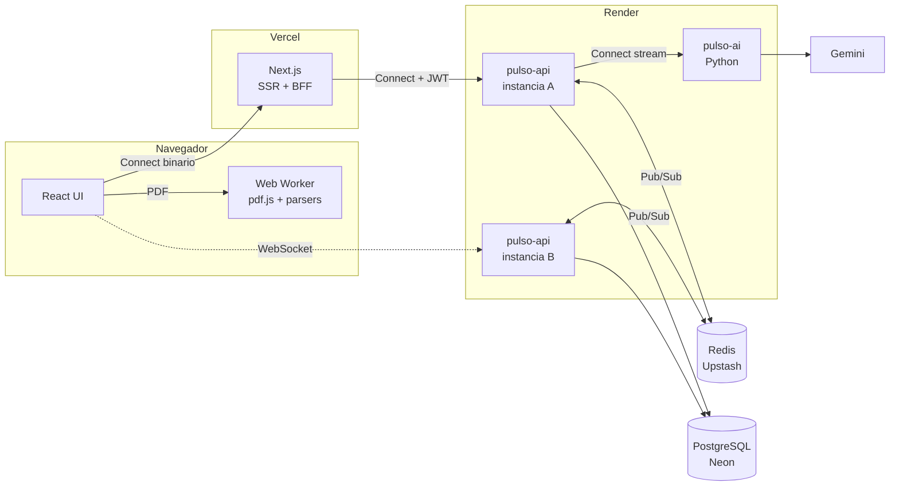
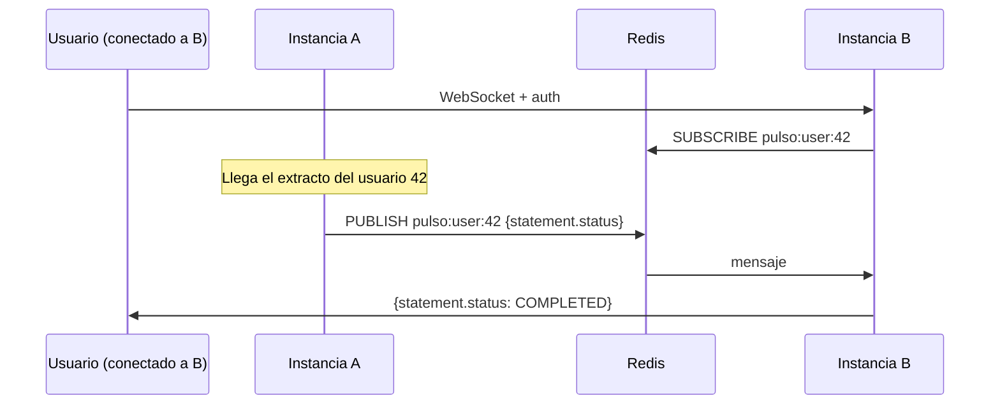

# pulso-api

Backend de **Pulso**, un sistema de análisis financiero que convierte extractos bancarios en PDF en información útil: categorías, gastos hormiga, cobros inusuales, pagos recurrentes y proyección de liquidez.

Este repositorio expone la API por **gRPC/ConnectRPC**, mantiene la **sesión de los usuarios**, guarda los datos en **PostgreSQL** y entrega eventos en **tiempo real por WebSocket**, sincronizando varias instancias con **Redis Pub/Sub**.

| Repositorio | Rol |
| --- | --- |
| [pulso-web](https://github.com/Jack-Limas/pulso-web) | Frontend Next.js: lee el PDF en un Web Worker, BFF, dashboard |
| **pulso-api** | Este repositorio: reglas de negocio, datos, sesión y tiempo real |
| [pulso-ai](https://github.com/Jack-Limas/pulso-ai) | Motor de análisis en Python: categorización, anomalías, proyección y Gemini |

Los tres repositorios **no comparten código**: se comunican solo a través de los contratos `.proto` documentados abajo, y cada uno guarda su propia copia.

---

## Arquitectura del sistema



| Comunicación | Protocolo | Por qué |
| --- | --- | --- |
| Navegador → Next | Connect sobre HTTP/1.1, protobuf binario | El navegador no puede hablar gRPC puro; Connect usa el mismo contrato |
| Next → API | Connect | El BFF agrega el token de la cookie `httpOnly` |
| API → IA | **gRPC nativo HTTP/2** en Docker, **Connect HTTP/1.1** en Render | El proxy de Render no entrega HTTP/2 de extremo a extremo |
| Navegador → API | WebSocket | Eventos que el servidor empuja al usuario |
| API ↔ API | Redis Pub/Sub | Las instancias nunca se hablan directamente |

### Topología de despliegue

| Servicio | Plataforma | Notas |
| --- | --- | --- |
| `pulso-web` | Vercel | `API_URL` apunta a la instancia A y `NEXT_PUBLIC_WS_URL` a la B, a propósito |
| `pulso-api-a`, `pulso-api-b` | Render (gratis) | Mismo código, distinto `INSTANCE_ID` |
| `pulso-ai` | Render (gratis) | Servidor Connect; gRPC nativo solo en Docker |
| PostgreSQL | Neon | `DATABASE_URL` con pooler y `DIRECT_DATABASE_URL` sin pooler |
| Redis | Upstash | Conexión TCP, necesaria para suscripciones |

Como el frontend envía las peticiones a la instancia A y abre el WebSocket contra la B, **producción demuestra el backplane en cada carga**: el evento nace en A, viaja por Redis y lo entrega B.

En local, `docker compose --profile demo` levanta lo mismo con **nginx** como balanceador round robin, sin sticky sessions.

---

## Contratos de interfaz (`proto/pulso/v1`)

Los contratos se validan con `buf lint` y el código se genera con `buf generate`. Cualquier cambio debe ser **aditivo**: campos nuevos con números nuevos, nunca reutilizar ni cambiar el tipo de uno existente, porque los otros repositorios tienen copias.

| Servicio | Procedimiento | Acceso | Descripción |
| --- | --- | --- | --- |
| `AuthService` | `Register`, `Login` | Público | Devuelven el access token; el refresh token va en una cookie `httpOnly` |
| | `RefreshSession`, `Logout` | Cookie | Rotan o revocan el refresh token |
| | `GetCurrentUser` | Usuario | Perfil y rol |
| `BankAccountService` | `ListSupportedBanks` | Público | Catálogo de bancos (página ISR del frontend) |
| | `ListBankAccounts`, `CreateBankAccount`, `DeleteBankAccount` | Usuario | Un usuario puede tener cuentas en varios bancos |
| `StatementService` | `UploadStatement` | Usuario | Recibe transacciones ya extraídas, el hash SHA-256 del PDF y las métricas |
| | `ListStatements`, `GetStatement` | Usuario | Paginación por token |
| | `ListTransactions` | Usuario | Filtros por extracto, categoría, tipo y texto |
| | `ListCategories`, `UpdateTransactionCategory` | Usuario | La corrección se convierte en regla para ese comercio |
| `InsightsService` | `GetDashboard` | Usuario | Totales, categorías, anomalías, recurrentes, hormiga, liquidez y consejos |
| `AdminService` | `BroadcastAnnouncement`, `ListUsers`, `UpsertMerchantRule`, `GetPlatformMetrics` | Admin | El interceptor rechaza a cualquier otro rol |

Dinero siempre en **centavos `int64`**, nunca en flotantes. Fechas como texto ISO `YYYY-MM-DD`.

### Contrato con el motor de IA (`proto/pulso/ai/v1`)

```proto
service AnalysisEngineService {
  rpc AnalyzeStatement(AnalyzeStatementRequest) returns (stream AnalyzeStatementResponse);
}
```

Es un **stream de servidor**: el motor emite una respuesta por cada etapa (`CATEGORIZING`, `DETECTING_ANOMALIES`, `FINDING_PATTERNS`, `FORECASTING`, `RECOMMENDING`) y al final el `AnalysisReport`. La API reenvía cada etapa al usuario por WebSocket. Toda llamada lleva el encabezado `x-internal-key`.

### Contrato del WebSocket (`/ws`)

1. El cliente abre la conexión y su **primer mensaje** es `{"type":"auth","token":"<access token>"}`. El token no va en la URL, para que no quede en los logs.
2. El servidor responde `{"type":"ready"}`, o cierra con código `4401` si el token no es válido o no llega en 5 s.
3. Después solo el servidor envía mensajes JSON:

| `type` | Campos | Cuándo |
| --- | --- | --- |
| `statement.status` | `statementId`, `status`, `failureReason?` | `RECEIVED`, `PROCESSING`, `ANALYZING`, `COMPLETED`, `FAILED` |
| `statement.stage` | `statementId`, `stage` | Cada etapa del motor de IA |
| `transaction.updated` | `transactionId` | El usuario cambió una categoría |
| `announcement` | `title`, `body` | Anuncio del admin a todos los usuarios |

---

## Tiempo real: backplane con Redis

**El problema:** cada conexión vive en la RAM de una sola instancia. Si el usuario está conectado a B y el evento ocurre en A, A no tiene cómo entregarlo.

**Por qué no sticky sessions:** atan a cada usuario a un servidor, desbalancean la carga y, si ese servidor cae, todos sus usuarios se desconectan a la vez.

**La solución, el patrón backplane:** ninguna instancia habla con otra. Todas publican en Redis y se suscriben a los canales que necesitan.



- **Fan-out:** `pulso:broadcast` lleva un mensaje a todos los conectados en todas las instancias, y `pulso:user:{id}` a todos los dispositivos de un usuario.
- **Suscripción bajo demanda:** una instancia solo se suscribe al canal de un usuario mientras tenga al menos un socket suyo. Así no procesa tráfico ajeno.
- **Dos conexiones a Redis:** una conexión en modo suscriptor no puede publicar.
- **Presencia:** cada instancia reporta sus usuarios en `pulso:presence:{instancia}` con expiración. Si una instancia muere, deja de contar sola.
- **Robustez:** heartbeat con ping/pong cada 30 s, cierre de clientes que no leen (más de 1 MB en búfer), validación de `Origin` y límite de 16 KB por mensaje.

---

## Diseño interno

```
src/
  config/        variables de entorno validadas con Zod al arrancar
  rpc/           rutas, interceptores (errores, autenticación) y contexto de la petición
  modules/
    auth/         registro, login, rotación de sesión, argon2id y JWT
    bank-accounts/
    statements/   validación de cargas, normalización de comercios, cola y procesador
    transactions/
    analysis/     cliente del motor de IA y persistencia del reporte
    insights/     armado del dashboard
    admin/
  realtime/      gateway WebSocket, registro de conexiones, backplane y presencia
  shared/        errores de dominio, paginación, fechas y cola de procesamiento
  container.ts   raíz de composición: el único lugar que conecta clases concretas
```

Cada módulo sigue la misma forma: `types` (contratos) → `service` (reglas) → `repository` (Prisma) → `handlers` (traducción a protobuf).

| Patrón | Dónde | Para qué |
| --- | --- | --- |
| Repository | `*.repository.ts` | Las reglas no conocen Prisma; las pruebas usan repositorios en memoria |
| Service Layer | `*.service.ts` | La lógica no vive en los handlers |
| Composition Root / inyección de dependencias | `container.ts` | Cambiar una implementación sin tocar a quien la usa |
| Chain of Responsibility | Interceptores de `rpc/` | Errores y autenticación se aplican a todos los procedimientos |
| Adapter / Gateway | `analysis-engine.client.ts` | Elige Connect o gRPC nativo con la variable `AI_TRANSPORT` |
| Publish/Subscribe | `realtime/` | El backplane entre instancias |

| Estructura de datos | Dónde | Por qué |
| --- | --- | --- |
| `Map<userId, Set<WebSocket>>` | `ConnectionRegistry` | Búsqueda O(1) de los sockets de un usuario; varios dispositivos por usuario |
| Cola FIFO con índice de cabeza | `ProcessingQueue` | Desencolar en O(1) y limitar a 2 extractos simultáneos |
| `Map` por categoría y por fuente | `analysis.repository.ts` | Una sola actualización por grupo dentro de una transacción |
| `Set` | Procedimientos públicos, ids del extracto, usuarios en línea | Pertenencia en O(1); un usuario en dos instancias cuenta una vez |

### Seguridad

- Contraseñas con **argon2id**; el login hace el mismo trabajo aunque el correo no exista, para no revelar qué correos están registrados.
- **Access token JWT** de 15 minutos y **refresh token** aleatorio de 30 días, guardado solo como hash SHA-256.
- **Rotación de refresh:** cada renovación invalida el anterior. Si un token rotado reaparece pasados 10 s, se asume robado y se cierran todas las sesiones del usuario. Dentro de esos 10 s se tolera, porque dos pestañas pueden renovar al mismo tiempo. Un token cerrado con *logout* nunca se acepta.
- Aislamiento por usuario en cada consulta (`where userId`); acceder a datos ajenos responde `NOT_FOUND`, sin confirmar que existen.
- Los errores inesperados se registran en el servidor y el cliente solo recibe `internal`.

---

## Ejecutar en local

Requisitos: Node 22, Docker.

```bash
cp .env.example .env
docker compose up -d
npm install
npm run generate
npx prisma migrate deploy
npm run db:seed
npm run dev
```

### Demo completa con dos instancias, nginx e IA por gRPC nativo

Con `pulso-ai` clonado al lado de este repositorio y `AI_INTERNAL_KEY` y `JWT_ACCESS_SECRET` definidos en `.env`:

```bash
docker compose --profile demo up -d --build
```

`http://localhost:8080/health` responde alternando `api-a` y `api-b`. Un servicio `migrate` aplica las migraciones una sola vez antes de que arranquen las instancias.

### Variables de entorno

| Variable | Obligatoria | Descripción |
| --- | --- | --- |
| `DATABASE_URL`, `DIRECT_DATABASE_URL` | Sí | PostgreSQL con y sin pooler |
| `REDIS_URL` | Sí | Redis con conexión TCP |
| `JWT_ACCESS_SECRET` | Sí | Mínimo 32 caracteres, **igual en todas las instancias** |
| `AI_SERVICE_URL`, `AI_INTERNAL_KEY` | Sí | Motor de análisis y su clave compartida |
| `AI_TRANSPORT` | No | `connect` (por defecto) o `grpc` |
| `INSTANCE_ID` | No | Nombre de la instancia, visible en `/health` |
| `CORS_ORIGINS` | No | Orígenes permitidos, separados por coma; también se usa para el WebSocket |
| `SEED_ADMIN_EMAIL`, `SEED_ADMIN_PASSWORD` | No | Si existen, `db:seed` crea el usuario admin |

Las categorías y los bancos se cargan con una **migración de datos**, así existen en cualquier entorno sin depender del seed.

### Pruebas

```bash
npm test          # 74 pruebas: autenticación, cuentas, extractos, tiempo real, admin y dashboard
npm run typecheck
npm run lint:proto
```

Las pruebas usan un transporte en memoria de Connect y repositorios falsos. Las del gateway abren **WebSockets reales contra dos instancias** unidas por un backplane en memoria.

El CI de GitHub Actions corre lint de contratos, generación, tipos, pruebas y build en cada push.
